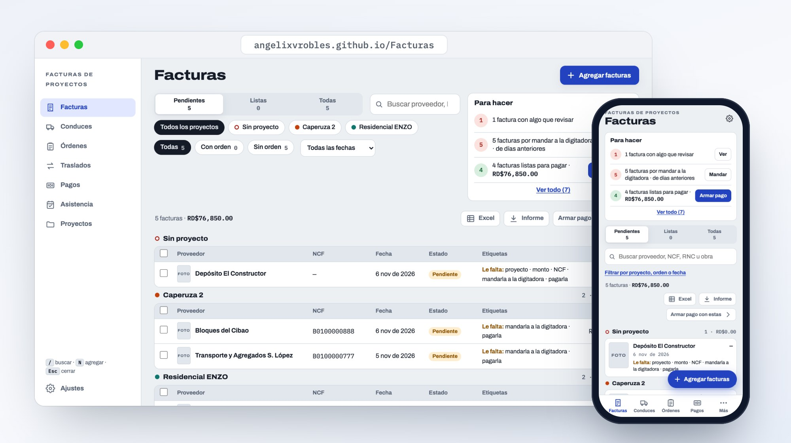

# Facturas de Proyectos

> **PWA para el control de compras de una constructora en República Dominicana**: órdenes de compra, facturas por obra, conduces, pagos con su PDF y su Excel, y el pase de lista de los obreros. Lee el QR de la factura electrónica de la DGII (e-CF) y, si se quiere, las facturas de papel con IA. **Local-first**: todo vive en el aparato y funciona sin internet.




**App en vivo:** https://angelixvrobles.github.io/Facturas/ — en el iPhone, ábrela en Safari y usa *Compartir → Agregar a pantalla de inicio*. &nbsp;·&nbsp; **[Manual de uso →](docs/manual.md)**

---

## Qué es

En una obra, las facturas llegan en papel, en fotos por WhatsApp y como factura electrónica. Alguien tiene que ordenarlas por proyecto, comprobar el NCF y el RNC, juntarles el conduce y la orden de compra firmada, y presentar cada pago con su relación. Esta app hace ese recorrido de punta a punta desde el teléfono de quien compra, y le da a la oficina y al dueño la misma información sin pedirla por mensaje.

No necesita servidor ni cuenta: se publica en GitHub Pages, se instala como app y guarda todo en el aparato. La nube es opcional.

## Lo que hace

- **Factura electrónica (e-CF):** lee el QR de la DGII —e-NCF, RNC del emisor y del comprador, fecha y monto— e importa el XML con el ITBIS, sin IA y sin costo. Cada factura enlaza a la verificación oficial de la DGII.
- **Facturas de papel:** con una clave de la API de Claude, lee proveedor, RNC, NCF, ITBIS, total, obra y orden de compra, y detecta los artículos tachados.
- **Validaciones fiscales:** factura de consumo que no sirve para crédito fiscal, NCF vencido o incompleto, dígito verificador del RNC, factura a nombre de otro RNC, posibles repetidas y notas de crédito.
- **Órdenes de compra** en el formato de la empresa, con un QR: cuando llega la foto de la orden firmada, la app la reconoce y la adjunta sola.
- **Cruce orden ↔ conduce ↔ factura:** avisa si una factura cobra más de lo que suman sus conduces o si llegó más material del que pidió la orden.
- **Pagos:** PDF para presentar —portada, totales por proyecto y por proveedor, firmas, y cada factura con sus conduces y su orden firmada— y un Excel detallado con varias hojas y filtros.
- **La obra completa:** presupuesto contra lo gastado, traslados de materiales entre obras con su hoja firmada y las cuentas entre obras, pase de lista quincenal de los obreros e informe quincenal para el jefe.
- **Equipo (opcional):** nube con Supabase que sincroniza el teléfono, la computadora y el teléfono del dueño, que aprueba los pagos desde el suyo.
- **Seguridad y respaldo:** PIN por aparato, historial de cada factura, papelera de 30 días, respaldo `.zip` y respaldos automáticos en la nube.

El detalle de cada función está en el **[manual de uso](docs/manual.md)**.

## Cómo está hecha

| Capa | Decisión |
|---|---|
| App | HTML y JavaScript sin framework ni paso de build: se publica tal cual en GitHub Pages |
| Datos | IndexedDB en el aparato; respaldo `.zip` con todos los archivos |
| Nube (opcional) | Supabase: Postgres y Storage privados, registro cerrado; solo entran los usuarios que crea la empresa ([`nube/supabase.sql`](nube/supabase.sql)) |
| DGII | Módulo propio para NCF y e-NCF, RNC (dígito verificador módulo 11), QR y XML de la e-CF ([`js/rd.js`](js/rd.js)) |
| Documentos | PDF con pdf-lib, lectura de PDF con PDF.js, y Excel y `.zip` generados en el navegador |
| IA (opcional) | API de Claude llamada desde el aparato con la clave del usuario; la clave no sale del aparato ni va en los respaldos |
| Sin internet | Service worker; cada aparato se actualiza solo, sin pasar por la App Store |

## Pruebas

26 suites con Playwright que usan la app como lo haría una persona —agregar facturas, conduces, órdenes, pagos, el pase de lista— y revisan el resultado, incluido el contenido de los PDF y los Excel. Usan solo datos inventados y no necesitan internet ni claves.

```bash
node pruebas/correr.js
```

Requisitos y detalle en [`pruebas/README.md`](pruebas/README.md).

## Licencia

© 2026 AngelixVrobles. **Uso gratuito**: cualquiera puede instalarla y usarla sin pagar; no se permite venderla ni copiar, modificar o publicar el código sin permiso por escrito. Texto completo en [`LICENSE`](LICENSE).

---

**Angelix Vásquez R.** · [GitHub](https://github.com/AngelixVrobles)
